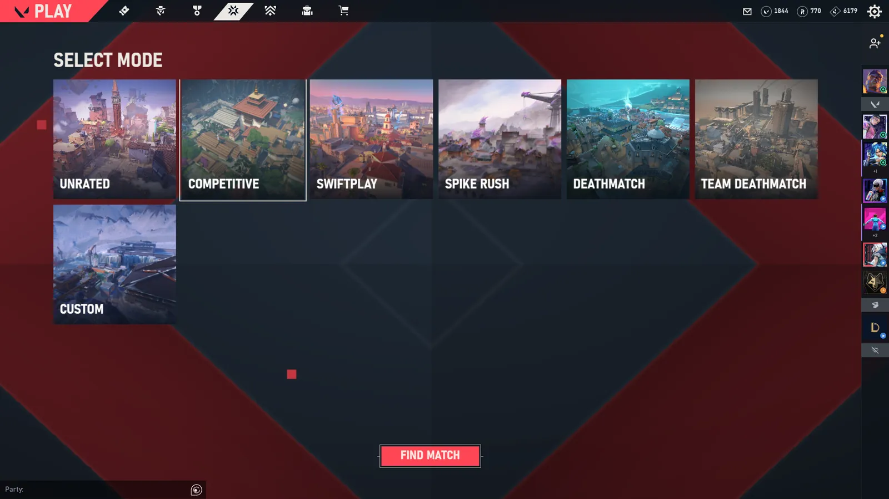

<div align="center">

# ValoShell

**Your VALORANT menu, your way.**
A free, open-source menu for VALORANT you design yourself.

[Website](https://s1moscs.dev/valoshell) · [Build](#build) · [Report a bug](https://github.com/Soulhackzlol/ValoShell/issues)



</div>

> [!NOTE]
> **Early preview.** ValoShell was built for a video. Expect bugs, unfinished screens and
> changes between versions.

## Features

| | |
|---|---|
| **Play** | Queues, party invites and codes, ready checks, custom games |
| **Agent select** | Your team's picks and the timer; select or lock in from the menu |
| **Lobby** | Rank, peak, RR, win rate and party stacks. Enemy ranks in agent select are opt-in |
| **Post-match** | Full scoreboard, your stats, RR change |
| **Store** | Daily offers, bundles, accessories, Night Market |
| **Collection** | Every skin, chroma and level; equip from the menu |
| **Career** | Rank, act history, match history |
| **Studio** | Drag, resize and restyle every piece; save it as a layout |
| **Styles** | 14 looks, from the VALORANT client to CS 1.6, Minecraft and a Pip-Boy |
| **Streaming** | Streamer mode hides names, plus an [InstantClone](https://github.com/Soulhackzlol/InstantClone) delay widget |

<p align="center">
  
  
</p>

## How it works

ValoShell talks to the Riot Client already running on your PC, through the same local API the
official client uses. Nothing to log in to, nothing injected into the game. It covers the menus,
steps aside when a match starts and comes back when it ends.

## Build

Requires Windows 10/11, [Rust](https://rustup.rs) 1.96+ and [Node.js](https://nodejs.org) 22+.

```sh
npm install
npm run dev      # app with live reload
npm run build    # release build in target/release
npm run ui:dev   # menu in the browser with demo data, no VALORANT needed
```

## Test

```sh
cargo test --workspace
npm run ui:check && npm run ui:test
```

## Layout

| Path | Contents |
|---|---|
| `crates/domain` | Game rules and data parsing, no I/O |
| `crates/riot` | Local Riot Client and VALORANT APIs |
| `crates/store` | Settings and layouts |
| `crates/services` | Live state: party, agent select, lobby, store, collection, career |
| `app` | Tauri desktop shell |
| `ui` | SolidJS menu, styles and Studio |

## License

[GPL-3.0-or-later](LICENSE)

<sub>ValoShell isn't endorsed by Riot Games and doesn't reflect the views or opinions of Riot
Games or anyone officially involved in producing or managing Riot Games properties. Riot Games
and all associated properties are trademarks or registered trademarks of Riot Games, Inc.</sub>
