<div align="center">


# ValoShell

### Your VALORANT menu, your way.

A free, open-source **custom menu for VALORANT**. Fourteen styles, a drag-and-drop layout
studio and everything the client does: play, party, store, collection and career.

[](https://github.com/Soulhackzlol/ValoShell/actions/workflows/ci.yml)
[](LICENSE)


[](https://github.com/Soulhackzlol/ValoShell/releases/latest)

**[Website](https://s1moscs.dev/valoshell)** · **[Download](https://github.com/Soulhackzlol/ValoShell/releases/latest)** · **[Build from source](#build-from-source)** · **[Report a bug](https://github.com/Soulhackzlol/ValoShell/issues/new/choose)**

</div>

> [!NOTE]
> **First public release.** ValoShell was built for a video, so you may still find rough edges.
> [Reports](https://github.com/Soulhackzlol/ValoShell/issues/new/choose) help a lot.

<br>

## Pick a style

Every style is a complete menu, not a colour swap: its own navigation, panels, fonts and layout.

<table>
  <tr>
    <td width="33%">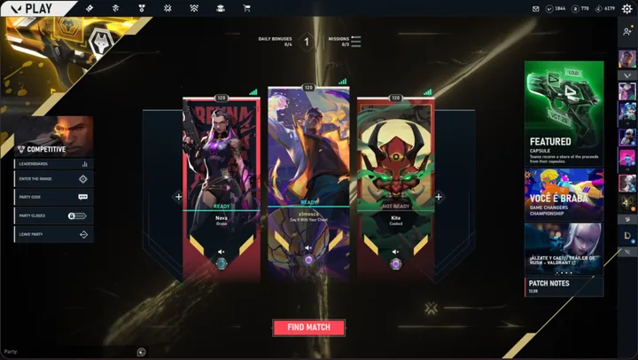<p align="center"><b>VALORANT</b></p></td>
    <td width="33%">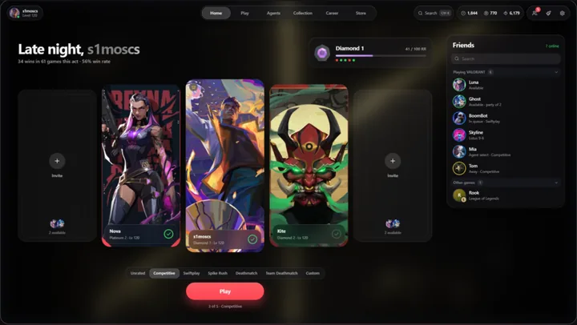<p align="center"><b>VALORANT Glass</b></p></td>
    <td width="33%">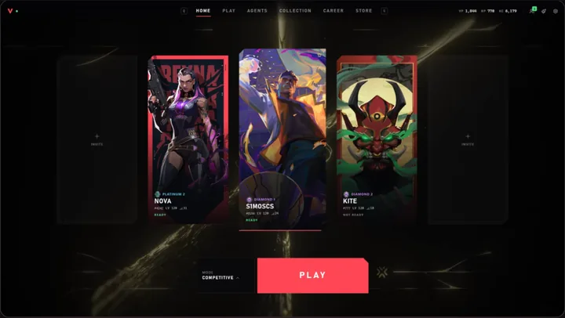<p align="center"><b>Modern</b></p></td>
  </tr>
  <tr>
    <td>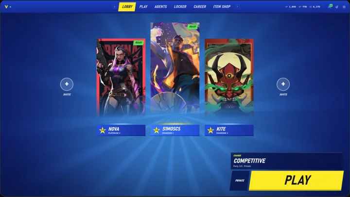<p align="center"><b>Fortnite</b></p></td>
    <td>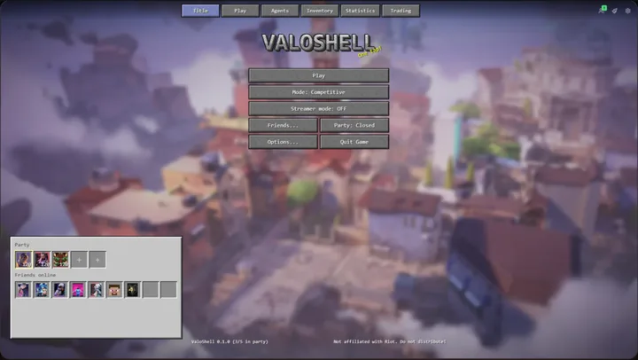<p align="center"><b>Minecraft</b></p></td>
    <td>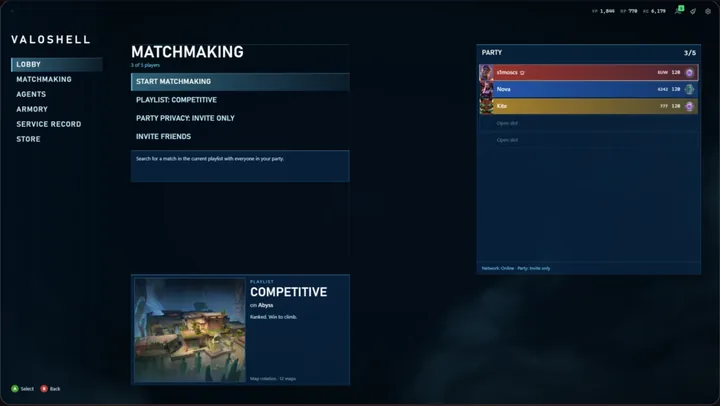<p align="center"><b>Halo 3</b></p></td>
  </tr>
  <tr>
    <td>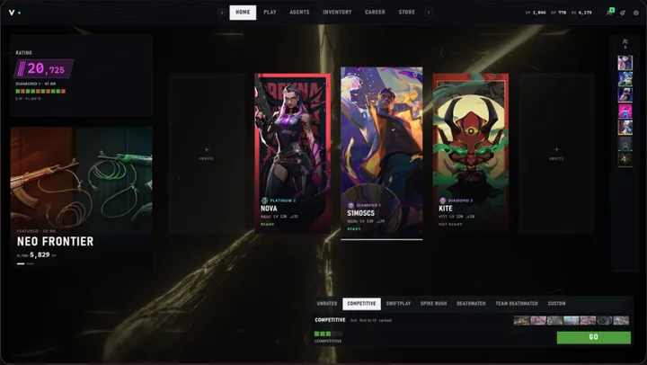<p align="center"><b>CS2</b></p></td>
    <td>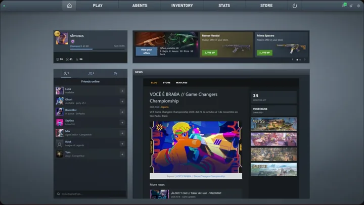<p align="center"><b>CS:GO</b></p></td>
    <td>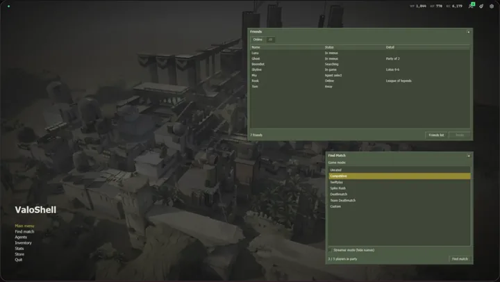<p align="center"><b>CS 1.6</b></p></td>
  </tr>
  <tr>
    <td>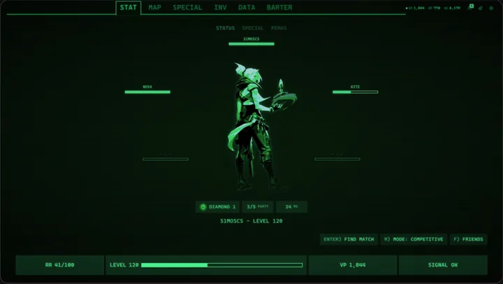<p align="center"><b>Pip-Boy</b></p></td>
    <td>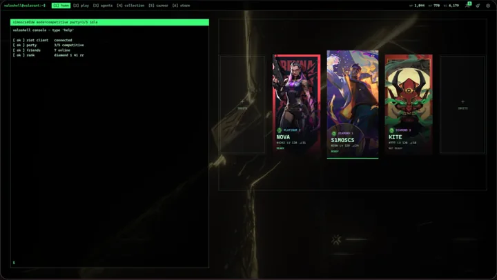<p align="center"><b>Terminal</b></p></td>
    <td align="center"><b>+ 3 more</b><br><sub>VALORANT Beta, VALORANT 2022<br>and the League client</sub></td>
  </tr>
</table>

## Make it yours

<table>
  <tr>
    <td width="50%" valign="top">
      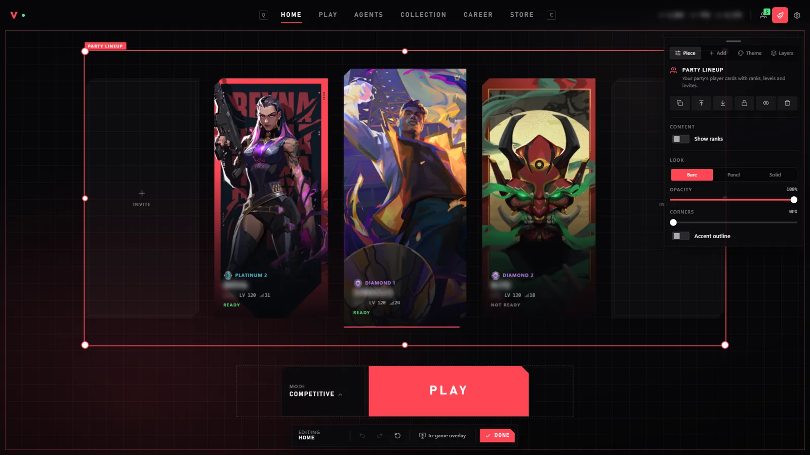
      <h3>Studio</h3>
      Drag, resize and restyle every piece of every page. Colours, fonts, corners, grain and
      backdrop are yours to change, and layouts save in one click.
    </td>
    <td width="50%" valign="top">
      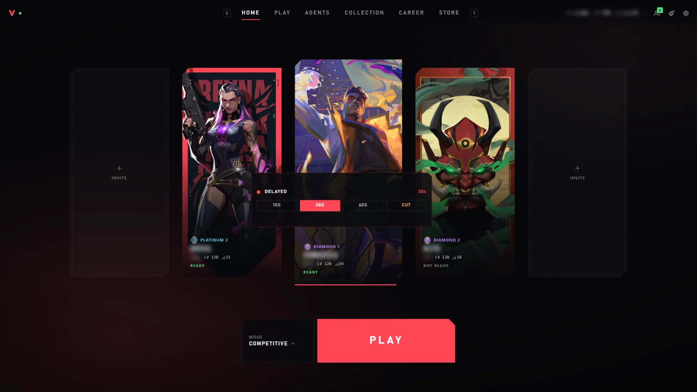
      <h3>Made for streaming</h3>
      Streamer mode hides every name on screen. The
      <a href="https://github.com/Soulhackzlol/InstantClone">InstantClone</a> widget sets your
      stream delay or cuts back to live without leaving the menu.
    </td>
  </tr>
</table>

## Everything the client does

| | |
|---|---|
| 🎮 **Play** | Queues, party invites and codes, ready checks, custom games |
| 🧩 **Agent select** | Your team's picks and the timer; select or lock in from the menu |
| 📊 **Lobby** | Rank, peak rank, RR, win rate and party stacks for every player |
| 🏁 **Post-match** | The full scoreboard, your stats and your RR change |
| 🛒 **Store** | Daily offers, bundles, accessories and the Night Market |
| 🔫 **Collection** | Every skin, chroma and level; equip straight from the menu |
| 🏆 **Career** | Rank, act history and match history |
| 👥 **Social** | Friends with their status and mode, plus the latest VALORANT news |

<details>
<summary><b>See the screens</b></summary>
<br>

| Agent select | Lobby |
|---|---|
| 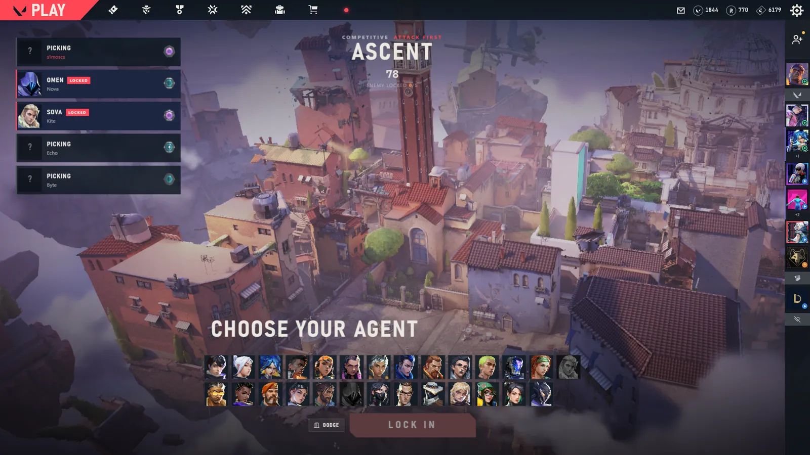 | 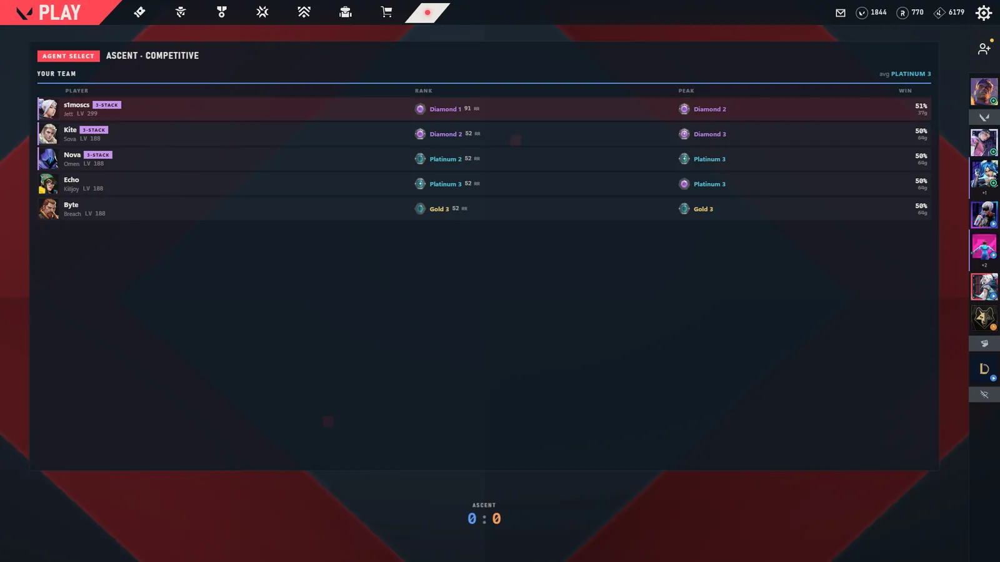 |
| **Store** | **Collection** |
| 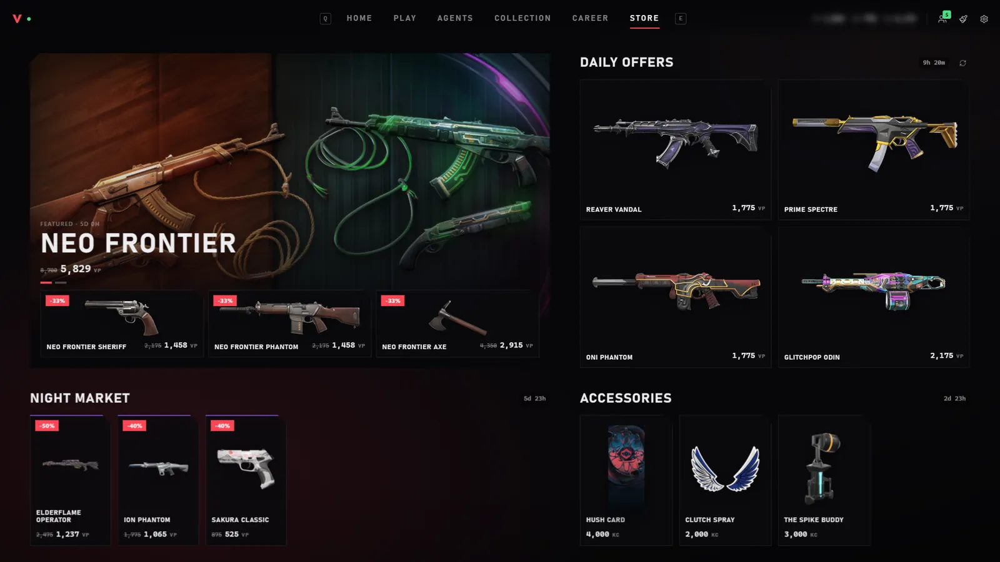 | 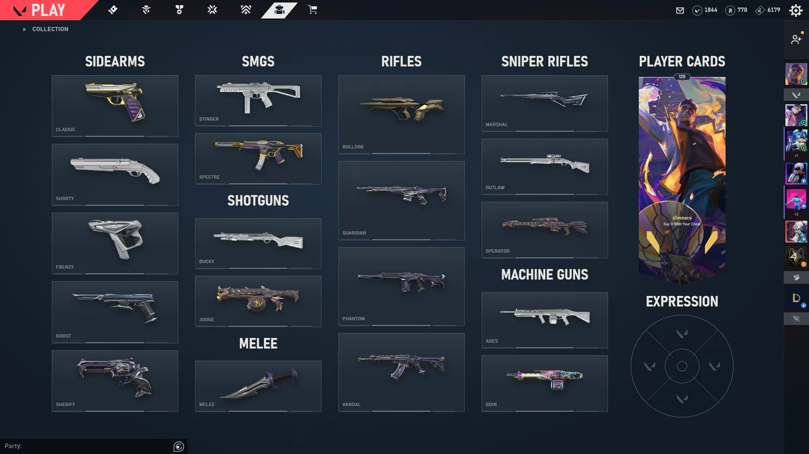 |
| **Career** | **Post-match** |
| 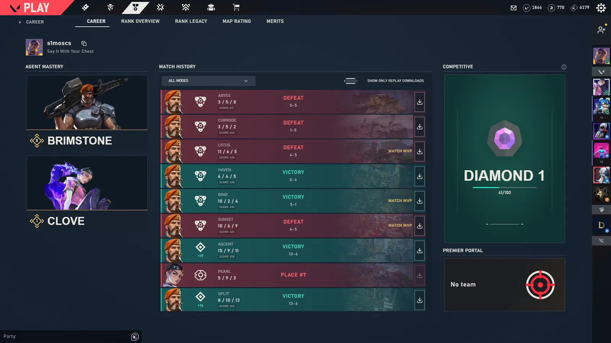 | 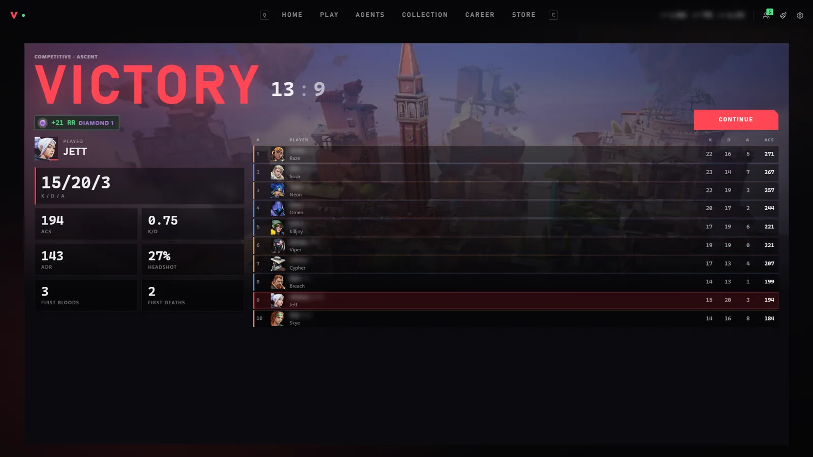 |

</details>

## How it works

ValoShell talks to the **Riot Client already running on your PC**, through the same local API
the official client uses. It covers the menus, steps aside when your match starts and comes
back when it ends.

- **Nothing to log in to.** Your session comes from the Riot Client.
- **Nothing touches the game.** No injection, no memory reading, no input automation.
- **Opt-in extras.** Enemy ranks during agent select are off by default and never requested
  unless you turn them on.

## Download

Grab the latest build from [Releases](https://github.com/Soulhackzlol/ValoShell/releases/latest),
start VALORANT's Riot Client, then open ValoShell.

The build isn't code-signed, so Windows may say *"Windows protected your PC"*: click **More info**,
then **Run anyway**. Each release lists the file's SHA-256 in `SHA256SUMS.txt`.

## Build from source

You need Windows 10/11, [Rust](https://rustup.rs) 1.96+ and [Node.js](https://nodejs.org) 22+.

```sh
git clone https://github.com/Soulhackzlol/ValoShell
cd ValoShell
npm install
npm run dev       # the app with live reload
npm run build     # a release build in target/release
npm run ui:dev    # just the menu in a browser, with demo data
```

Run the checks with `cargo test --workspace`, `npm run ui:check` and `npm run ui:test`.

<details>
<summary><b>Project layout</b></summary>
<br>

| Path | Contents |
|---|---|
| `crates/domain` | Game rules and data parsing, no I/O |
| `crates/riot` | Local Riot Client and VALORANT APIs |
| `crates/store` | Settings and saved layouts |
| `crates/services` | Live state: party, agent select, lobby, store, collection, career |
| `app` | The Tauri desktop shell |
| `ui` | The SolidJS menu, styles and Studio |

</details>

## FAQ

<details>
<summary><b>Is ValoShell safe to use with VALORANT?</b></summary>
<br>
It only reads and sends what the official client can, through the Riot Client's local API, and
never touches the game process. Like any third-party tool it isn't endorsed by Riot, so use it
at your own discretion.
</details>

<details>
<summary><b>Windows says it protected my PC. Is it a virus?</b></summary>
<br>
No. The build isn't code-signed, so SmartScreen warns about any new download like it. Click
<b>More info</b>, then <b>Run anyway</b>. Every release lists the file's SHA-256 in
<code>SHA256SUMS.txt</code>, so you can check your download, scan it on VirusTotal or build it yourself.
</details>

<details>
<summary><b>ValoShell doesn't open. What do I do?</b></summary>
<br>
It needs Microsoft's <a href="https://developer.microsoft.com/microsoft-edge/webview2/">WebView2 Runtime</a>.
Windows 11 already has it and most Windows 10 PCs too; if yours doesn't, install it and try again.
Still nothing? <a href="https://github.com/Soulhackzlol/ValoShell/issues/new/choose">Open an issue</a>.
</details>

<details>
<summary><b>Does it replace the VALORANT client?</b></summary>
<br>
It replaces the menus. The game itself still runs through the Riot Client, and ValoShell hands
over to it when a match starts.
</details>

<details>
<summary><b>Is it free?</b></summary>
<br>
Yes. Free and open source under the GPL-3.0.
</details>

<details>
<summary><b>Can I make my own style?</b></summary>
<br>
Studio lets you restyle and rearrange any of the built-in styles. Adding a brand-new style
currently means adding it in code; see <a href="CONTRIBUTING.md">CONTRIBUTING.md</a>.
</details>

## Contributing

Bug reports, ideas and pull requests are welcome. Start with [CONTRIBUTING.md](CONTRIBUTING.md).

## More by s1moscs

- **[InstantClone](https://github.com/Soulhackzlol/InstantClone)**: change your stream delay without restarting the stream.

## License

[GPL-3.0-or-later](LICENSE) © s1moscs

<sub>ValoShell isn't endorsed by Riot Games and doesn't reflect the views or opinions of Riot
Games or anyone officially involved in producing or managing Riot Games properties. Riot Games
and all associated properties are trademarks or registered trademarks of Riot Games, Inc.</sub>
